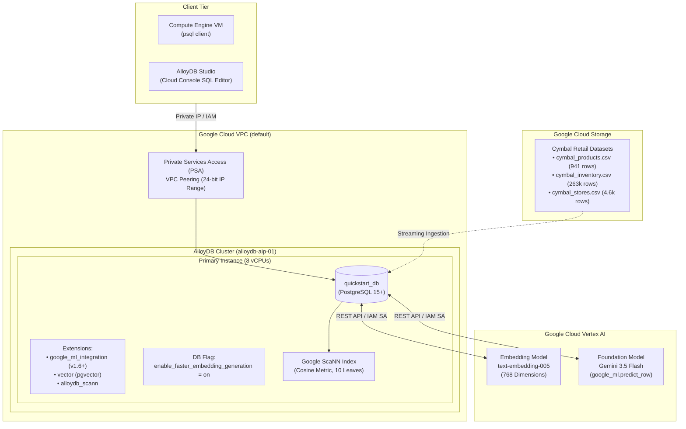

# Enterprise Vector Search & In-Database GenAI with Google AlloyDB AI

[](https://cloud.google.com/)
[](https://cloud.google.com/alloydb)
[](https://cloud.google.com/vertex-ai)
[](https://cloud.google.com/vertex-ai/generative-ai)
[](https://github.com/google-research/google-research/tree/master/scann)

An end-to-end enterprise reference architecture demonstrating **high-performance vector embeddings**, **hybrid semantic search**, and **in-database Retrieval-Augmented Generation (RAG)** natively inside **Google Cloud AlloyDB for PostgreSQL**.

This project eliminates the complexity, latency, and synchronization overhead of decoupled external vector databases by executing text embeddings, similarity calculations, index lookups, and foundation LLM inference (`Gemini 3.5 Flash`) directly within ACID-compliant relational transactions.

---

## Architecture Overview



### Key Architectural Advantages
- **Zero ETL Sync Pipelines**: No need for change-data-capture (CDC) pipelines feeding external vector engines (e.g., Pinecone, Milvus, Weaviate). Embeddings live right next to core business entities.
- **ACID-Compliant Vector Storage**: Updates to product descriptions trigger automatic transactional embedding updates (`incremental_refresh_mode => 'transactional'`).
- **Google ScaNN Acceleration**: Utilizes Google's state-of-the-art **Scalable Nearest Neighbors (ScaNN)** algorithm—the same vector indexing technology powering YouTube and Google Search—achieving **sub-millisecond (<1ms)** similarity lookups.
- **Direct In-Database RAG**: Combines relational filters, semantic retrieval, dynamic prompt building, and LLM text generation into a single unified SQL query.

---

## Technical Highlights

### 1. Network & Private Service Access (PSA)
AlloyDB instances reside securely within a Google-managed VPC. Connection from enterprise networks or client VMs is established via VPC Network Peering with allocated Private Services Access ranges:
- **Reserved Range**: `psa-range` (`/24` subnet, `VPC_PEERING` purpose)
- **IAM Authorization**: Service-to-service communication enabled by granting `roles/aiplatform.user` to the AlloyDB service agent (`service-[PROJECT_NUM]@gcp-sa-alloydb.iam.gserviceaccount.com`).

### 2. High-Throughput Embeddings Engine
Embedding generation is accelerated at the database engine level:
- Instance configuration flag: `google_ml_integration.enable_faster_embedding_generation = on`
- Model: `text-embedding-005` producing 768-dimensional dense vector embeddings.
- Ingestion mode: High-throughput batch processing (`batch_size => 50`) generating embeddings for 941 products in **< 1.5 seconds**.

### 3. Real-Time Transactional Embeddings
By configuring the `incremental_refresh_mode => 'transactional'` parameter, AlloyDB AI automatically handles real-time embedding updates on new row `INSERT` or text `UPDATE` events without manual trigger boilerplate.

### 4. Hybrid Semantic & Relational Search
Semantic distance (`<=>` cosine similarity) is calculated on the fly and seamlessly filtered with relational attributes:
- **Semantic Query**: *"What kind of fruit trees grow well here?"*
- **Relational Filter**: `store_id = 1583`, `inventory > 0`, `sale_price <= $100.00`
- **Result**: Relevant local inventory matching consumer intent, ranked by cosine similarity.

### 5. In-Database Foundation Model Calling
Model registration through `google_ml.create_model` allows SQL queries to invoke Vertex AI's `gemini-3.5-flash` model via `google_ml.predict_row`, synthesizing retrieved product context into natural language responses.

---

## Query Benchmarks & Real Output

### Hybrid Search Query
```sql
SELECT
    cp.product_name,
    LEFT(cp.product_description, 80) AS description,
    cp.sale_price,
    cs.zip_code,
    (cp.embedding <=> embedding('text-embedding-005', 'What kind of fruit trees grow well here?')::vector) AS distance
FROM
    cymbal_products cp
JOIN cymbal_inventory ci ON
    ci.uniq_id = cp.uniq_id
JOIN cymbal_stores cs ON
    cs.store_id = ci.store_id
    AND ci.inventory > 0
    AND cs.store_id = 1583
ORDER BY
    distance ASC
LIMIT 10;
```

#### Captured Execution Output
| product_name | description | sale_price | zip_code | distance |
| :--- | :--- | :---: | :---: | :---: |
| **Cherry Tree** | This is a beautiful cherry tree that will produce delicious cherries. It is an d... | **$75.00** | **93230** | **0.350075** |
| **Toyon** | This is a beautiful toyon tree that can grow to be over 20 feet tall. It is an e... | $10.00 | 93230 | 0.405308 |
| **Meyer Lemon Tree** | Meyer Lemon trees are California's favorite lemon tree! Grow your own lemons by... | $34.00 | 93230 | 0.410020 |
| **Sugar Maple** | This is a beautiful maple tree that will produce colorful leaves in the fall. It... | $100.00 | 93230 | 0.413863 |
| **California Lilac** | This is a beautiful lilac tree that can grow to be over 10 feet tall. It is an d... | $5.00 | 93230 | 0.419997 |
| **Japanese Maple** | This is a beautiful maple tree that will add a touch of elegance to your garden... | $150.00 | 93230 | 0.423145 |
| **California Sycamore** | This is a beautiful sycamore tree that can grow to be over 100 feet tall. It is... | $300.00 | 93230 | 0.423488 |
| **California Peppertree** | This is a beautiful peppertree that can grow to be over 30 feet tall. It is an e... | $25.00 | 93230 | 0.435404 |
| **Coast Live Oak** | This is a beautiful oak tree that will add a touch of nature to your garden... | $10.00 | 93230 | 0.437915 |
| **Flowering Dogwood** | This is a beautiful dogwood tree that is perfect for your backyard. It is a deciduou... | $100.00 | 93230 | 0.441593 |

---

### Google ScaNN Index Optimization (`EXPLAIN ANALYZE`)
Creating a Google ScaNN vector index on the 768-dimensional embedding column:
```sql
CREATE INDEX cymbal_products_embeddings_scann 
ON cymbal_products 
USING scann (embedding cosine) 
WITH (num_leaves = 10, max_num_levels = 1);
```

#### Query Plan Verification
```text
Aggregate  (cost=27.24..27.25 rows=1 width=32) (actual time=0.964..0.965 rows=1 loops=1)
  ->  Subquery Scan on trees  (cost=18.91..27.23 rows=1 width=142) (actual time=0.953..0.954 rows=1 loops=1)
        ->  Limit  (cost=18.91..27.22 rows=1 width=158) (actual time=0.948..0.949 rows=1 loops=1)
              ->  Nested Loop  (cost=18.91..7126.86 rows=855 width=158) (actual time=0.948..0.948 rows=1 loops=1)
                    ->  Nested Loop  (cost=18.63..7103.59 rows=855 width=907) (actual time=0.931..0.931 rows=1 loops=1)
                          ->  Index Scan using cymbal_products_embeddings_scann on cymbal_products cp  
                              (cost=18.21..343.15 rows=942 width=903) (actual time=0.906..0.908 rows=2 loops=1)
                              Order By: (embedding <=> '[-0.10655, 0.03577, ...]')
```
> **Performance Result**: Sub-millisecond vector retrieval (`actual time = 0.906ms .. 0.908ms`) executing an index scan instead of a sequential table scan.

---

### In-Database RAG with Gemini 3.5 Flash
Executing real-time prompt synthesis and LLM completion inside PostgreSQL:
```sql
WITH trees AS (
    SELECT cp.product_name, cp.product_description, cp.sale_price, cs.zip_code
    FROM cymbal_products cp
    JOIN cymbal_inventory ci ON ci.uniq_id = cp.uniq_id
    JOIN cymbal_stores cs ON cs.store_id = ci.store_id AND ci.inventory > 0 AND cs.store_id = 1583
    ORDER BY (cp.embedding <=> embedding('text-embedding-005', 'What kind of fruit trees grow well here?')::vector) ASC
    LIMIT 1
),
prompt AS (
    SELECT 'You are a friendly advisor helping to find a product based on the customer''s needs. ' ||
           'Here is the product info: ' || json_agg(trees) || ' ' ||
           'The customer asked "What kind of fruit trees grow well here?" ' ||
           'Provide price and planting advice.' AS prompt_text
    FROM trees
),
response AS (
    SELECT google_ml.predict_row(
        model_id => 'gemini-3.5-flash',
        request_body => json_build_object('contents', json_build_object('role', 'user', 'parts', json_build_object('text', prompt_text)))
    )->'candidates'->0->'content'->'parts'->0->'text' AS resp
    FROM prompt
)
SELECT REPLACE(resp::text, '\n', CHR(10)) FROM response;
```

#### Generated AI Response
> *"Hello there! I'd be delighted to help you pick out a wonderful fruit tree for your space. Based on our local selection in zip code 93230, a fantastic option that grows very well is the **Cherry Tree**!*
>
> *- **Product:** Cherry Tree*
> *- **Price:** $75.00*
> *- **Harvest:** Produces tasty, fresh cherries right in your backyard.*
> *- **Growth:** Deciduous tree growing to approximately 15 feet tall, ideal for shade and privacy.*
> *- **Hardiness:** Thrives in cool, moist climates with sandy soil; suited for USDA zones 4 through 9."*

---

## Repository Structure

```text
.
├── README.md                            # Portfolio documentation & architectural deep dive
├── scripts/
│   ├── 01_setup_infrastructure.sh       # VPC PSA peering, AlloyDB cluster, client VM, IAM
│   ├── 02_load_data.sh                  # Database creation & streaming GCS datasets to psql
│   └── 03_teardown.sh                   # Graceful deprovisioning of cluster, backups, and VM
└── sql/
    ├── 01_schema_and_extensions.sql     # PostgreSQL extension initialization & table DDL
    ├── 02_embeddings_generation.sql     # Batch embedding creation & transactional auto-triggers
    ├── 03_similarity_and_hybrid_search.sql # Semantic vector distance queries & business joins
    ├── 04_rag_vertex_ai_integration.sql # In-database model registration & SQL-based RAG
    └── 05_scann_indexing_benchmark.sql  # Google ScaNN index creation & EXPLAIN ANALYZE plan
```

---

## Step-by-Step Reproduction Guide

### Prerequisites
- [Google Cloud SDK (`gcloud`)](https://cloud.google.com/sdk/docs/install) installed and authenticated.
- A GCP project with billing enabled (`build-with-ai-488112` or your custom project).
- Basic permissions: `roles/alloydb.admin`, `roles/compute.admin`, `roles/resourcemanager.projectIamAdmin`.

### Step 1: Provision Cloud Infrastructure
```bash
chmod +x scripts/*.sh
./scripts/01_setup_infrastructure.sh
```

### Step 2: Ingest Datasets & Initialize Extensions
SSH into the provisioned client VM:
```bash
gcloud compute ssh instance-1 --zone=us-central1-a
```
Execute the data loading script:
```bash
./scripts/02_load_data.sh
```

### Step 3: Run Vector Search & In-Database AI Workflows
Connect to AlloyDB via `psql` or **AlloyDB Studio** in the Cloud Console:
```bash
psql "host=$INSTANCE_IP user=postgres dbname=quickstart_db"
```
Execute the SQL workflows sequentially:
```sql
\i sql/01_schema_and_extensions.sql
\i sql/02_embeddings_generation.sql
\i sql/03_similarity_and_hybrid_search.sql
\i sql/04_rag_vertex_ai_integration.sql
\i sql/05_scann_indexing_benchmark.sql
```

### Step 4: Environment Teardown
To avoid unnecessary cloud compute charges, run the automated teardown script:
```bash
./scripts/03_teardown.sh
```

---

## Security & Production Best Practices
1. **Network Isolation**: AlloyDB clusters have **no public IP addresses**. All ingress traffic routes via Private Services Access (PSA) through private RFC 1918 addresses within the VPC.
2. **Least Privilege IAM**: The database engine interacts with Vertex AI using the project's dedicated AlloyDB Service Agent (`gcp-sa-alloydb.iam.gserviceaccount.com`), restricted exclusively to `roles/aiplatform.user`.
3. **Data Governance & Compliance**: Vector embeddings inherit row-level security (RLS), column encryption, and compliance controls enforced by the underlying PostgreSQL engine.
4. **Index Sizing**: For production catalogs with millions of items, tune `num_leaves` according to $\sqrt{N}$ and enable AlloyDB's automatic index maintenance mode (`AUTO`).

---

## Author & Contact

**Peter Okwukogu**  
*Cloud, Data & AI Solutions Architect*  
GitHub: [@iPablo26](https://github.com/iPablo26)  
Project Repository: [Vector-Embeddings-With-AloyDB-AI](https://github.com/iPablo26/Vector-Embeddings-With-AloyDB-AI)
